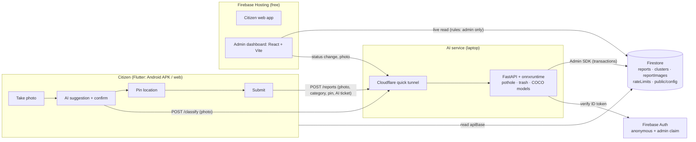

# Design

## Architecture overview

- **All writes go through the API**, which validates input, applies the rules in one Firestore transaction, and strips photo metadata. Browsers can never write to Firestore (security rules deny it).
- **Admins read reports and clusters directly from Firestore**, with live listeners. The security rules require the `admin` custom claim.
- **Finding the API address:** the laptop's API is reachable through a Cloudflare quick tunnel. `tools/serve_public.py` publishes the tunnel URL to the public Firestore doc `public/config.apiBase`, and both apps read it at runtime.

## Components

| Component | Responsibility | Technology |
|-----------|----------------|------------|
| Citizen app (`app/`) | Photo → AI suggestion → confirm → location → review → receipt; "My reports" | Flutter 3 (Android + web), flutter_map + Esri tiles, geolocator |
| Admin dashboard (`admin/`) | Sign-in (admin claim gate), KPIs, map, reports list (priority sort, filters), photo, status change, hotspots | React 19, Vite, TypeScript, react-leaflet, Firebase JS SDK |
| API (`api/`) | Validate uploads, run models, decide outcome, sign AI tickets, create reports (merge, hotspots, rate limits, duplicate photos), admin status / photo endpoints | FastAPI, onnxruntime, Pillow, OpenCV (headless), firebase-admin |
| Decision rules (`api/app/decide.py`) | Turn raw model scores into issue / uncertain / not_issue + reason | Python, calibrated on `eval/set1` |
| Clustering (`api/app/clustering.py`) | 25 m / 7-day merge, 50 m / 30-day hotspot, geohash-7 + neighbours lookup | Python (pure functions, unit-tested) |
| Firestore rules (`firebase/`) | Deny all client writes; admin-only reads; public read of `public/config` only | Firestore security rules + emulator tests |
| Public server (`tools/serve_public.py`) | Start the API + tunnel, publish the URL, watchdog reconnect | Python, cloudflared |

## Data model

| Collection | Key fields | Written by |
|---|---|---|
| `reports/{RA-XXXXXX}` | `category`, `lat`, `lng`, `geohash`, `accuracyM`, `locationSource` (gps / manual_pin), `outsidePakistan`, `status`, `statusHistory[]`, `clusterId`, `reporterUid`, `note`, `createdAt`, `aiOutcome`, `aiCategory`, `aiConfidence`, `aiReason`, `aiCheckedBy` (client / server), `userCorrected`, `userOverride`, **`verification`** (verified / unverified / ai_rejected), `imageSha256`, `imageDHash`, `imageDHashBands[]`, `photoReusedFrom`, `demoSample` | API only |
| `reportImages/{reportId}` | `jpeg` (EXIF-free, ≤ 1280 px, ≤ 900 KB), `createdAt` | API only |
| `clusters/{C-XXXXXX}` | `category`, `centroidLat/Lng`, `geohash`, `reportCount`, `firstAt`, `lastAt`, `isHotspot`, `nearbyCount30d`, `status` | API only |
| `rateLimits/{key}` | `windowStart`, `count` (fixed window) | API only |
| `public/config` | `apiBase`, `updatedAt` | `tools/serve_public.py` |

## API / interfaces

| Method | Endpoint / interface | Purpose | Auth required |
|--------|----------------------|---------|---------------|
| GET | `/health` | Liveness, models loaded, store type | No |
| POST | `/classify` | Photo → `{outcome, category, confidence, reason, boxes, ticket}`; **creates nothing** | Firebase ID token (anonymous OK) |
| POST | `/reports` | Create a report (multipart: image, category, lat, lng, accuracyM, locationSource, note, aiTicket) | Firebase ID token |
| GET | `/reports/{id}` | Public status (no location, no photo) | No |
| POST | `/admin/reports/{id}/status` | Change status, append history | ID token with `admin` claim |
| GET | `/admin/reports/{id}/image` | Stored (clean) photo | ID token with `admin` claim |
| GET | `/download/RaastaAI.apk` | Demo APK from the laptop (backup to the GitHub Release) | No |
| Firestore | `reports`, `clusters` (read) | Admin dashboard live data | `admin` claim (rules) |
| Firestore | `public/config` (get) | Apps discover the API URL | No |

## Key decisions and tradeoffs

| Decision | Options considered | Chosen | Why | Tradeoff accepted |
|----------|--------------------|--------|-----|-------------------|
| Detection models | Train our own; Roboflow API; public pretrained YOLOv8 | Pretrained YOLOv8 (pothole-seg, trash-seg, COCO) exported to ONNX | Judges required verified pretrained models; no training time; runs offline on CPU | Pothole recall is modest on out-of-domain photos |
| Garbage model | kendrickfff YOLOv8l-det vs turhancan YOLOv8m-seg | turhancan | P 0.75 / R 0.75 vs P 0.57 / R 0.25 on street scenes; faster; smaller | 104 MB file, kept out of git |
| AI can't create reports | AI auto-files vs AI suggests and the citizen confirms | Suggest + confirm, using an HMAC "ticket" that binds the AI result to the exact photo and user | Judge requirement; prevents faking "verified" | One extra tap for the citizen |
| AI service hosting | Hugging Face Space, Cloud Run, laptop + tunnel | Laptop + Cloudflare quick tunnel | HF Docker Spaces now need PRO; Cloud Run needs billing; free-plans-only rule | Needs the laptop online; the URL changes on restart (published via Firestore, watchdog reconnects) |
| Database | Firestore, Supabase, SQLite on the laptop | Firestore (Spark) | Free, live listeners for the dashboard, security rules, transactions | 1 MiB document limit, so images are compressed to ≤ 900 KB in `reportImages` (no Storage on Spark) |
| Duplicate lookup | Full scan, PostGIS, geohash | Geohash-7 cell + 8 neighbours, then haversine | Works with Firestore `in` queries; covers > 50 m | A few extra candidate reads |
| Reused-photo detection | Exact hash only, perceptual hash | SHA-256 + 64-bit dHash, 4 × 16-bit bands for an `array_contains_any` lookup | Catches WhatsApp-resized copies; one indexed query | Very heavy edits or crops aren't caught |
| Spam from "AI found nothing" | Block entirely, allow freely, allow with friction | Allow with a ≥ 15-character note, ai_rejected tier, 2/hour, no hotspot weight | A real problem the AI misses can still be reported | Some spam possible, but it's ranked last |
| Map tiles | Google Maps (needs a billing card), OSM, CARTO, Esri | Esri World Street Map (no key) + OSM.de fallback | CARTO now needs a key; OSM's servers block app traffic; free-only rule | Esri attribution required; no satellite view |

## AI components

- **What the AI does:** it runs three models on each photo:
  - pothole segmentation (FarzadNekouee YOLOv8n-seg);
  - litter segmentation (turhancan97 YOLOv8m-seg);
  - a COCO detector used as a gate for people and animals.
- **How `decide.py` turns scores into an outcome:**
  - It returns `issue`, `uncertain` or `not_issue`, plus a reason: `blank_image`, `person_or_animal`, `no_issue_found`, `models_disagree`, `weak_evidence`, and so on.
  - The thresholds were calibrated on `eval/set1` and are documented in [MODEL_EVAL.md](MODEL_EVAL.md).
- **What our code validates around the AI:**
  - File type is checked by content. Size ≤ 8 MB, ≤ 40 MP, decompression-bomb guard, and EXIF orientation is applied before inference.
  - The AI result is only trusted through an HMAC-signed ticket. The ticket is bound to the photo's SHA-256 and the user, and expires after 1 hour.
  - A wrong or forged ticket is ignored, and the server re-checks the photo itself.
  - Category, coordinates, note and accuracy are validated on the server. AI-rejected photos need a note. Blank, person and animal photos are refused.
- **When the AI fails:**
  - A timeout (20 s) or the AI being unavailable shows "Couldn't analyse"; the citizen picks the category, and the report is saved as `unverified`.
  - On submit, the server tries the AI again (`aiCheckedBy: server`).
  - The citizen is never blocked from reporting a real problem.

## Security and privacy

### Threat model

| Threat | Mitigation |
|---|---|
| Citizen changes a report's status | Status endpoint checks the `admin` custom claim on the server; Firestore rules deny all client writes |
| Faking an "AI-verified" report | HMAC ticket bound to photo hash + uid + time; the server re-checks the photo when there's no valid ticket |
| Spam / flooding | Per-user, per-IP (hashed) and per-override rate limits inside the same transaction; anonymous auth required |
| Same photo reused to fake reports elsewhere | Exact + perceptual photo match: rejected beyond 25 m, flagged within 25 m |
| Malicious uploads | Type sniffing, size and pixel limits, decompression-bomb guard, re-encode to clean JPEG |
| Spoofed client IP | `CF-Connecting-IP` is trusted only from the loopback tunnel; otherwise the last `X-Forwarded-For` hop is used |
| Secret leakage | Service-account key and runtime secrets live only in git-ignored `secrets/`; the API refuses to start on a hosted Space with dev secrets |

### Data handled

- **Photos:** stored re-encoded, with **all metadata removed** (EXIF, GPS, ICC, XMP). Photos of people or animals are rejected before storage.
- **Location:** only the pin the citizen confirmed is stored. The public status endpoint doesn't return the location.
- **Identity:** an anonymous Firebase uid. IP addresses are only kept as salted hashes in rate-limit keys. Admins sign in with email and password.
- **Firebase web config** (`config/`, `app/lib/firebase_options.dart`, `admin/src/firebase.ts`): these are public client identifiers, not secrets. Access is enforced by Auth, the security rules and the API.

### Known limits

- Anonymous users can create new identities, so the per-IP limit is the backstop. A shared NAT can hit it.
- The perceptual hash doesn't catch heavily cropped or edited copies.
- The release APK is signed with a debug key; it's for demo installs only.
- The AI service has no high availability: if the laptop is offline, analysis and new reports are unavailable. Hosted pages and existing data stay readable.
